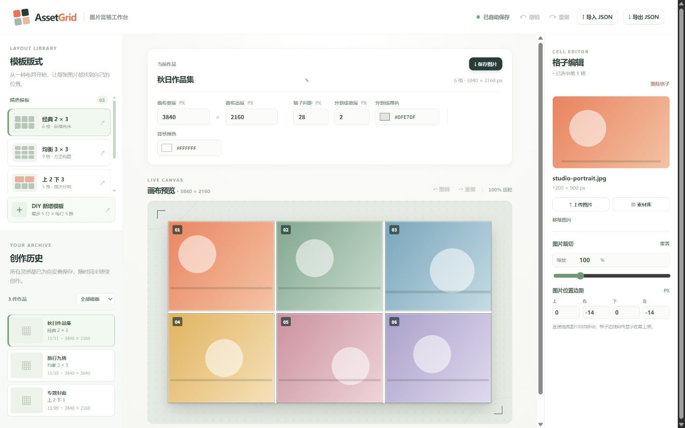
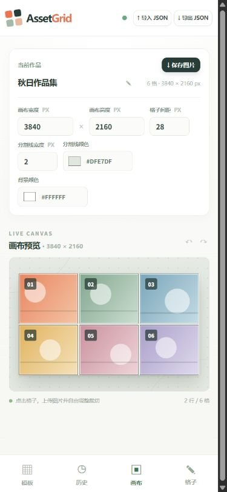

# AssetGrid Image Grid Studio

<p>
  <a href="./README.md"></a>
  <a href="./README.en.md"></a>
  
  
</p>

A browser-only image grid editor. Pick a layout, drop images into cells, move and zoom them freely, then export the finished collage. Works, custom templates, and image assets stay in your browser. No account and no backend required.



## Interface preview

| Desktop | Mobile |
| --- | --- |
|  |  |

## Features

- **Layout templates**: three built-in layouts plus custom templates with up to five rows and five cells per row.
- **Canvas and cells**: create square or rectangular canvases, set dimensions, resize rows and columns by dragging dividers, and rebalance a row automatically when a cell is removed.
- **Image cropping**: upload JPG, PNG, or WebP per cell, or reuse images from the local asset library. Drag freely inside a cell, pinch to zoom on touch screens, type a zoom value from 20% to 400%, and read or set the pixel distance from each cell edge.
- **Visual settings**: canvas size, gap width, background color, divider width, and divider color. Editing guides stay out of exported images.
- **Project management**: autosave to IndexedDB with previews, rename, duplicate, filter history by template, and resume editing later.
- **Export and backup**: export PNG or JPG, or export an `.assetgrid.json` backup that includes the images used by the project.

## Tech Stack

- Vue 3 + Vite
- IndexedDB for local storage
- HTML Canvas for rendering and export

No server-side dependency; images are never uploaded by the app.

## Quick Start

Requires Node.js 20 or later.

```sh
git clone https://github.com/NanYuJun/AssetGrid.git
cd AssetGrid
npm install
npm run dev
```

Production build:

```sh
npm run build
npm run preview
```

Build output is written to `dist/`.

## Usage

1. Choose a preset template in the left sidebar, or design a layout in the DIY template editor.
2. Set the canvas size when creating a work; dimensions, gap, background color, and dividers can be changed at any time.
3. Click a cell to add an image, drag to reposition it, then adjust zoom and edge distances as needed.
4. Use **Save image** to export PNG or JPG. Export JSON when you need to continue editing on another device.
5. Return to earlier works from creation history at any time.

## Project Structure

```text
src/
├── App.vue          # Editor UI and interaction state
├── main.js          # Vue entry point
├── styles.css       # Responsive visual design
└── lib/
    ├── canvas.js    # Grid geometry, image placement, and rendering
    └── db.js        # IndexedDB persistence
docs/
├── preview-desktop.jpg
└── preview-mobile.jpg
```

## Data and Privacy

Works, custom templates, previews, and image files are stored in the current browser's IndexedDB. Clearing browser site data removes local works and assets, so export a JSON backup first.

## License

Released under the [Apache License 2.0](./LICENSE).
