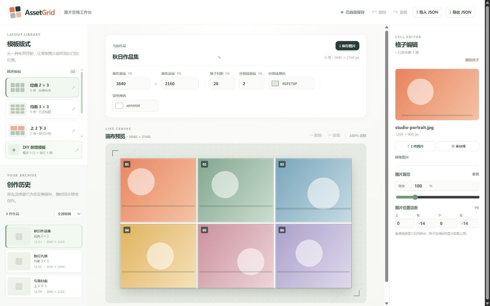
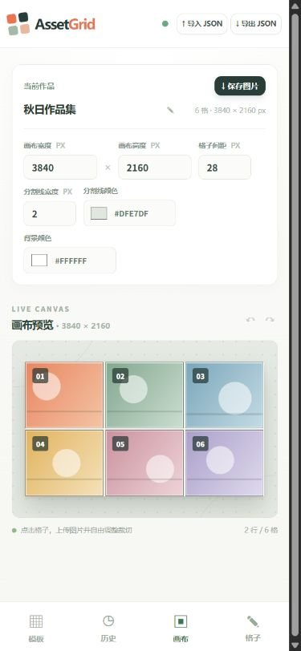

# AssetGrid 图片宫格工作台

<p>
  <a href="./README.md"></a>
  <a href="./README.en.md"></a>
  
  
</p>

纯前端图片宫格编辑器。选择一个版式，把图片放进格子，自由拖动和缩放，最后导出整张成品图。作品、DIY 模板和图片素材都保存在当前浏览器中，不需要账号，也没有后端服务。



## 功能预览

| 桌面 | 手机 |
| --- | --- |
|  |  |

## 功能

- **版式模板**：内置「经典 2 × 3」「均衡 3 × 3」「上 2 下 3」，也可以自行新增最多 5 行、每行最多 5 格的 DIY 模板，并长期保存复用。
- **画布与格子**：新建正方形或长方形画布并设置尺寸；拖动分隔线调整行列比例；删除格子后，同排剩余格子均分该行宽度。
- **图片裁切**：每格可上传 JPG、PNG、WebP，也能从素材库复用。图片在格内自由拖动、双指缩放，缩放比例可输入（20%–400%），并显示图片相对格子四边的像素距离。
- **视觉设置**：画布宽高、格子间距、背景颜色、分割线宽度和颜色均可调整；编辑辅助线只在编辑时显示。
- **作品管理**：自动保存到 IndexedDB 并生成预览图；支持重命名、复制、按模板筛选历史、继续编辑。
- **导出与备份**：导出 PNG / JPG 成品图，或导出包含图片的 `.assetgrid.json` 备份，换电脑后导入继续编辑。

## 技术栈

- Vue 3 + Vite
- IndexedDB 本地存储
- HTML Canvas 渲染与导出

无后端依赖，图片不会上传到服务器。

## 本地开发

需要 Node.js 20 或更高版本。

```sh
git clone https://github.com/NanYuJun/AssetGrid.git
cd AssetGrid
npm install
npm run dev
```

生产构建：

```sh
npm run build
npm run preview
```

构建产物位于 `dist/`。

## 使用流程

1. 在左侧选择预设模板，或进入 DIY 模板编辑器设计版式。
2. 新建作品时设置画布尺寸，之后可随时调整宽高、间距、背景色和分割线。
3. 点击格子添加图片，拖动调整位置，按需设置缩放和四边距离。
4. 点击「保存图片」导出 PNG 或 JPG；需要跨设备继续编辑时导出 JSON。
5. 在左侧创作历史中随时回到之前的作品。

## 项目结构

```text
src/
├── App.vue          # 编辑器界面与交互状态
├── main.js          # Vue 入口
├── styles.css       # 响应式界面样式
└── lib/
    ├── canvas.js    # 宫格几何、图片定位与渲染
    └── db.js        # IndexedDB 持久化
docs/
├── preview-desktop.jpg
└── preview-mobile.jpg
```

## 数据说明

作品、DIY 模板、预览图和图片文件都保存在当前浏览器的 IndexedDB 中。清理浏览器站点数据会删除本地作品与素材，清理前请先导出 JSON 备份。

## 开源协议

本项目采用 [Apache License 2.0](./LICENSE) 开源协议。
